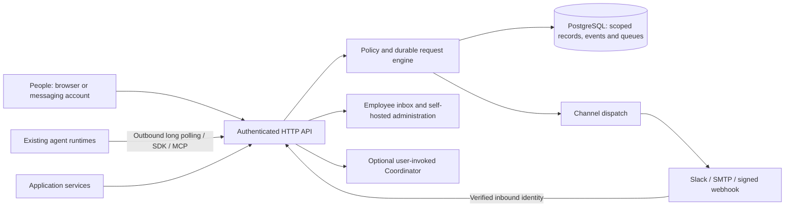

# Open source architecture

The product has a Go modular monolith, a React web app embedded into its binary, three language clients, an MCP stdio adapter and React/headless embeds. Channel adapters and optional Coordinator assistance are modules of the same engine. A PostgreSQL database is the only required stateful service. Mailpit is a local test aid.

## Public concepts

| Concept | Meaning and lifecycle |
| --- | --- |
| Company/workspace/environment | The deployment's scoped ownership boundary. A credential selects its scope; a request body cannot switch tenants. Company provisioning and managed tenancy UI belong to the later control plane. |
| Person | A human account created manually or on verified OIDC login. Department/manager are organizational facts, not grants. Disable revokes access without erasing history. No email-based account merging. |
| Agent | A stable logical runtime identity. Authorized first connection creates it, scoped by a launcher's enrollment namespace. The trusted enrollment owner and validated parent are distinct from descriptive project/type labels. |
| Instance | One authenticated connection/process under an agent, with its own expiring credential, heartbeat and reported progress. Logical-agent work goes to one eligible replica; an exact instance is explicit. |
| Software service | An ordinary application or trusted launcher. It can notify or ask through the same API without pretending to be a person or agent. |
| Group | Explicit membership defining an audience. It grants no capabilities by itself. Role bindings to a group give its current members those grants. |
| Role | Reusable allow rules. Missing grants deny. View, Message, Ask, Decide and Manage are separate. Resource/version/currency/amount/expiry conditions bound approvals. Enrollment is controlled by a distinct namespace-restricted credential. |
| Connection | A configured provider installation and encrypted server-side credentials. A type such as Slack is fixed; a connection has a user-chosen name. Multiple installations are supported. |
| Destination | A person/service/agent's physical address on a connection. Primary, fallback and explicit-copy modes control routing. A verified Slack origin thread is scoped to its conversation. |
| Conversation and message | Canonical private history and credential-derived authorship. Several conversations may contain the same participants. Private fan-out creates a separate conversation for each recipient. |
| Request | A durable question, approval or task. Open becomes resolved, cancelled, expired or superseded, with a typed resolution. Clarification and other questions do not cancel it. |
| Execution intent | An idempotently redeemed approval bound to exact executor, resource/version, arguments and operation key. Reports remain worker-reported evidence. |
| Shared answer | Published informational knowledge with source, author, publisher, explicit audience, key, expiry and invalidation. Reuse requires identical context and current responder authority. |

Credentials, delivery attempts, policy bookkeeping and events are implementation resources, not extra concepts required to send a message. IDs are server-generated. Caller-supplied external agent/person IDs bind stable application identities; names never authenticate anything.

## A complete interaction

1. A trusted launcher enrolls `research/scout`. The engine creates/binds its agent and issues an independent instance credential. Only explicit launcher role assignments are copied on first identity creation; root credential authority is never inherited.
2. The worker asks an allowed person or group. One transaction checks current policy, snapshots the audience, stores the request and private projections, queues delivery, writes events and stores the idempotency receipt.
3. A browser loads canonical records, then merges authorized canonical message events for the open conversation. Other conversations use lightweight metadata; request, identity and policy changes reconcile authoritative snapshots. The employee may clarify while every request keeps its own state. A Slack response also needs a verified immutable account link and current rights.
4. The first authorized terminal response wins under a workspace transaction lock. Removal from the targeted group or revocation of Decide can invalidate a pending responder.
5. The worker retrieves the durable answer or receives a leased result. An SDK wait is a client convenience and cannot make a stopped process resume automatically.
6. For a protected action, the exact executor redeems the approved descriptor. Current proposer/approver rights and conditions are checked again. The business tool must enforce this intent and its operation key at the actual effect.

## Durability and concurrency

PostgreSQL transactions commit canonical records, private fan-out, events, outbox rows and idempotency receipts together. A short per-workspace row lock makes event sequence and commit order agree. Provider/model network calls do not hold that lock. This first implementation prioritizes correctness; large-workspace throughput must be measured before making scale claims.

Worker leases are 30 seconds and carry increasing generations. An expired owner cannot acknowledge a replacement's lease. The listener claims one item at a time so a batch does not expire while an SDK handles earlier items. Long-running work must be handed off to a durable local job/checkpoint before acknowledging receipt.

PostgreSQL LISTEN/NOTIFY wakes outbound long polls across engine processes. It carries only scope/recipient identifiers. It is a hint; inbox rows are authoritative and bounded periodic reads recover missed hints. The listener uses one dedicated database connection in addition to the pool. Heartbeat writes are throttled. A stale/offline worker does not become an invented successful continuation.

The dashboard uses a cookie-authenticated resumable stream with `summary=1&conversation_id=...`. Only the selected readable conversation carries full `message.created` data. Other events keep their original visibility and cursors without transferring unused bodies. The browser merges by canonical message ID in timestamp/ID order, bounds history to the same last 500 messages as the HTTP API, and buffers events during snapshot reads. Reconnect uses `Last-Event-ID` ahead of the initial query cursor. A 15-second reconciliation remains independent of navigation for permission revocation, missed events and presence; policy and request events also trigger the original debounced refresh. Generic SDK full and summary streams are unchanged.

Provider sends are outside database atomicity. Definite temporary HTTP rejection has bounded retries, Retry-After and jitter. A permanent failure can trigger an explicit fallback. Lost responses or expired provider leases become Unknown and require reconciliation before replay. SMTP acceptance does not prove inbox delivery. Slack/API acceptance does not prove a person saw it.

## Authorization and data boundaries

Scope is fixed by authentication. Public collections remain separate People, Agents and Services; a private principal table shares policy/authentication machinery. Browser sessions are HttpOnly with origin checks. Provider callbacks derive actors from verified account mappings. Enrollment labels do not assign roles or ownership.

Current checks protect acceptance, sensitive dispatch, response, history/replay, reusable-answer retrieval and permit redemption. Route preview uses the same resolver/evaluator and hides recipient metadata without View. Groups/roles changes apply without waiting for worker reconnection. Already posted Slack room content is governed by Slack room membership; use private destinations for private data.

The engine enforces communication and explicit permit redemption. It cannot turn a runtime that feeds all chat text into unrestricted tools into a read-only agent. The supplied examples are communication-connected; the checkpoint example demonstrates durable continuation without claiming tool sandboxing.

Attachments are limited to 5 MiB and safe download types, stored under generated paths with conversation access checks. They are served as downloads with no-store/nosniff. Local disk is the supported attachment adapter. Multi-node deployments must share that directory with appropriate storage guarantees.

## Optional assistance and commercial boundary

Exact answers require an explicit scoped key and matching content, authorized publication and a declared reuse audience. Invalidated/expired/revoked publications stop reuse; historical consumers carry provenance and invalidation status. Coordinator is a separate user-invoked interface with bounded context and explicit confirmation before outbound work.

Fleet status is a read-only structured view of permitted instances and worker-reported progress, with timestamps and partial coverage. It does not infer an exact total from overlapping counts, execute commands or access private tools through a hidden overseer identity.

Commercial modules can add maintained directories, explicit external-group-to-role mapping, offboarding reconciliation, hosting/billing and governance through public interfaces. Keep that composition separate rather than maintaining an incompatible private engine fork. The open source distribution remains fully usable without those modules.

A group used as a role target is a live membership selector, so the same rule permits contacting an individual current member or the group. `$self` binds to the authenticated identity, not caller metadata. Group membership and role binding remain separate. Administration of roles, memberships, credentials and provider installations is owner-only in this release; delegated Manage supports scoped identity/profile/status operations and answer publication rather than unrestricted IAM delegation.
